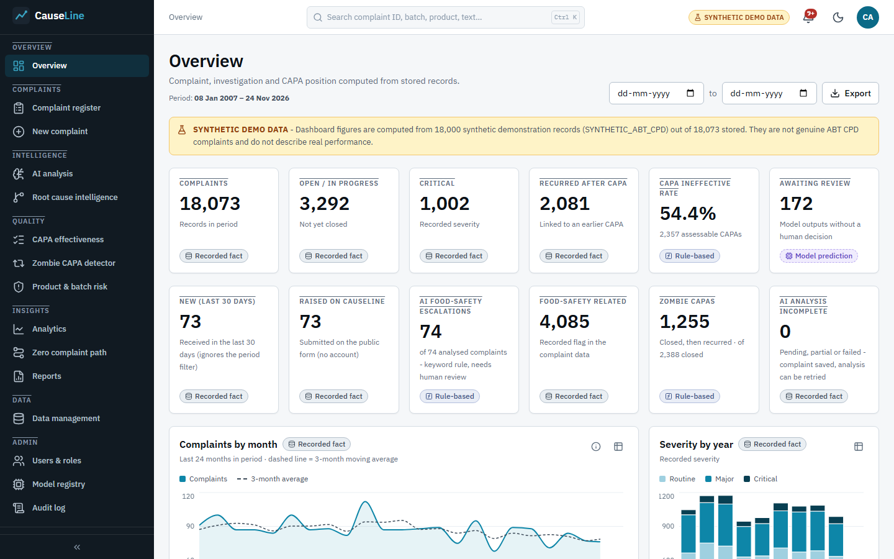
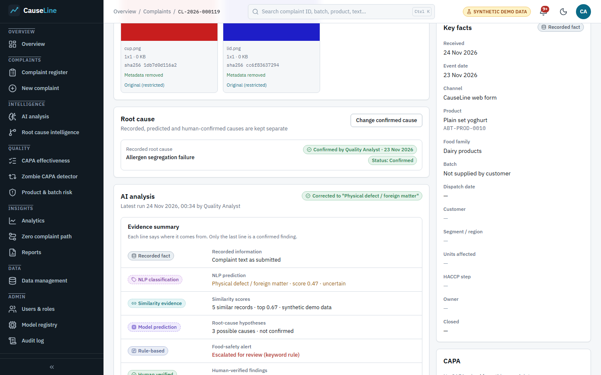
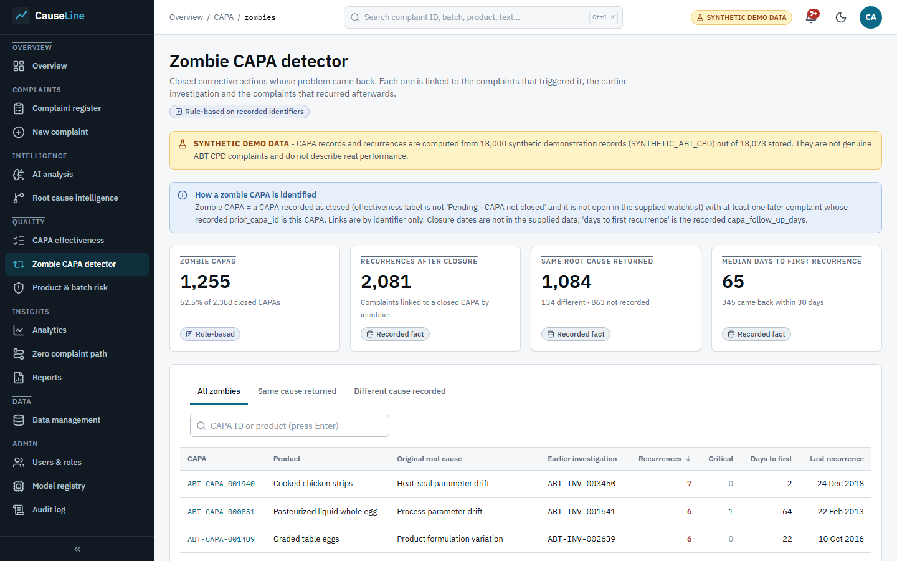
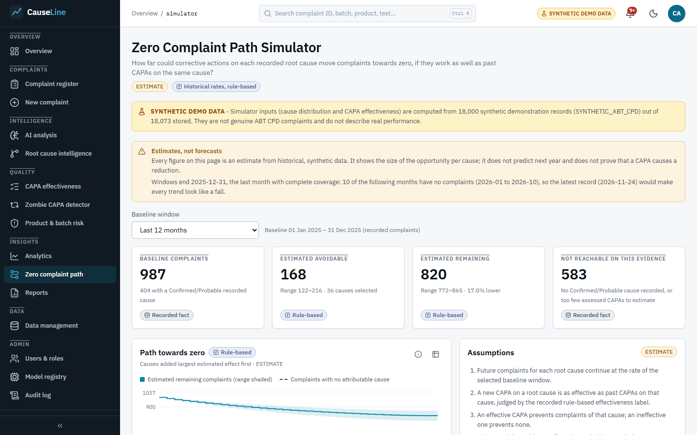
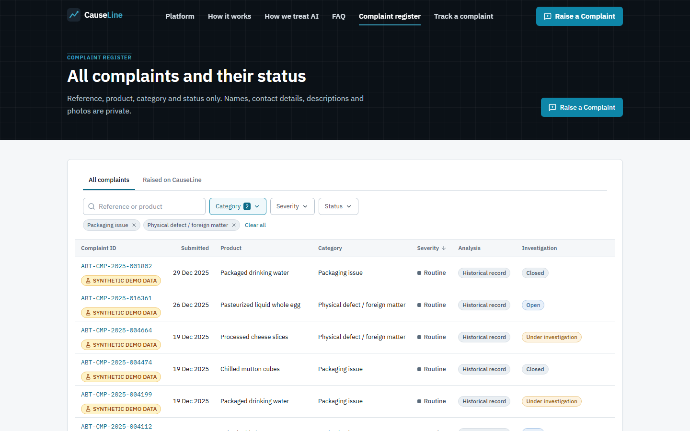

# CauseLine — ABT CPD Complaint Analytics & Prediction Platform

A full-stack complaint intelligence platform for food quality teams. **Anyone can raise a complaint without an account**: they attach photos, receive a reference number and a private access key, and see the real AI analysis. Quality staff investigate, verify and analyse in a protected staff area.

Every value on screen is labelled as **recorded fact**, **rule-based calculation**, **model prediction**, **similarity evidence**, **historical model output**, **human verified** or **insufficient data**, so a prediction is never shown as a confirmed fact.

> **All supplied data is synthetic** (`SYNTHETIC_ABT_CPD`). Nothing here describes real ABT CPD performance.

<p align="center">
  
  
</p>
<p align="center">
  
  
  
</p>

## What it does

| Area | Highlights |
|---|---|
| **Public complaint journey** | Step-by-step form with photo upload, duplicate protection, reference + access key, complaint tracking, anonymised public register |
| **NLP complaint intelligence** | Category and sub-category classification with uncertainty flags, food-safety flag, similar historical complaints (when enabled) |
| **Root cause intelligence** | Recorded vs. predicted vs. human-confirmed causes kept separate; reproduced and verified root-cause model |
| **CAPA effectiveness** | Recurrence after closure, Zombie CAPA detector (CAPAs that "closed" but the problem came back) |
| **Product & batch risk** | Historical batch-risk scores, repeat-complaint batches, HACCP control-point signals |
| **Analytics & reports** | Trends, Pareto, product comparison, Zero Complaint Path Simulator, printable reports |
| **Data management** | CSV/Excel upload with column mapping, validation, duplicate detection, import history, audit log |

## Architecture

```
Browser ──► React SPA (Vite)  ──/api──►  FastAPI  ──►  SQLAlchemy ──► SQLite / PostgreSQL
                                            │
                                            └──► ML service layer ──► supplied NLP + predictive model artifacts
```

| Layer | Stack | Location |
|---|---|---|
| Frontend | React 19, Vite 8, TypeScript, Tailwind 4, TanStack Query, Recharts, React Hook Form + Zod, Radix | `frontend/` |
| Backend | FastAPI, Pydantic 2, SQLAlchemy 2, pandas, scikit-learn 1.9.1, sentence-transformers | `backend/` |
| Database | SQLite (default) — PostgreSQL/Supabase via `DATABASE_URL` | `backend/data/` (not in git) |
| Models | Supplied packages, referenced in place + one verified reproduction | `AI_COMPLAINT_INTELLIGENCE/`, `ml_predictive_analytics (1)/`, `ml_project/reproduced/` |

The model folders keep their original names (including the space in `ml_predictive_analytics (1)`) because the backend references the supplied artifacts in place, unmodified.

## Quick start (Windows, PowerShell or Git Bash)

```bash
# 1. Backend
cd backend
py -3.14 -m venv .venv                       # Python 3.12+; verified on 3.14.7
.venv/Scripts/python -m pip install -r requirements.txt
cp .env.example .env                         # set JWT_SECRET
cd ..
backend/.venv/Scripts/python -I scripts/reproduce_root_cause_model.py   # optional: rebuild + verify the root-cause model
backend/.venv/Scripts/python backend/scripts/seed.py --admin-email you@company.com --with-analyst
#   -> prints generated passwords once (or set ADMIN_PASSWORD / ANALYST_PASSWORD beforehand)
cd backend && .venv/Scripts/python -m uvicorn app.main:app --host 127.0.0.1 --port 8000

# 2. Frontend (new terminal)
cd frontend
npm install
npm run dev                                  # http://localhost:5173  (proxies /api to :8000)
```

API docs (development only): http://127.0.0.1:8000/api/docs

## Deploy on Render

`render.yaml` deploys a free static site (the website) and a free Python web service (the API + models) from `main`: Render dashboard → **New → Blueprint** → select this repository. Steps, settings and free-plan limitations (similarity search off, sleep after idle, SQLite resets on restart) are in [docs/DEPLOYMENT_GUIDE.md](docs/DEPLOYMENT_GUIDE.md#render-free-plan---2026-11-24).

## Tests

```bash
cd backend && .venv/Scripts/python -m pytest -q              # 85 tests: ML parity, engines, API, public flow, images, privacy, uploads
cd frontend && npm test                                      # 12 component tests
cd frontend && npm run build                                 # type-check + production build
# with both servers running:
CL_EMAIL=<staff email> CL_PASSWORD=... npx playwright test   # E2E: public complaint + photos -> AI -> register, privacy, staff view (desktop + mobile)
```

## User journeys

| Who | Where | Account? |
|---|---|---|
| Visitor | `/` → **Raise a Complaint** (`/raise`) → result page `/complaint/<ID>` (reference + private key, AI analysis, photos) | No |
| Visitor | `/track` (reference + key), `/register` (anonymised list) | No |
| Quality staff | `/staff` → `/app` (dashboard, complaints, investigation notes, CAPA, root cause, analytics, reports, data upload, admin) | Yes — staff accounts are created by an administrator |

## Branches

| Branch | Purpose |
|---|---|
| `main` | Stable, deployable. Render deploys from here. |
| `develop` | Integration branch for ongoing work. Merge into `main` when tests pass. |
| `feature/<name>` | Short-lived branches off `develop`, one per change, deleted after merging. |

## Documentation

[`docs/`](docs/) — PROJECT_OVERVIEW, ARCHITECTURE, ML_MODEL_AUDIT, DATA_INVENTORY, DATA_DICTIONARY, DATA_QUALITY_REPORT, DATA_READINESS_REPORT, DATABASE_SCHEMA, API_DOCUMENTATION, TESTING_REPORT, DEPLOYMENT_GUIDE, KNOWN_LIMITATIONS, DESIGN_SYSTEM.
